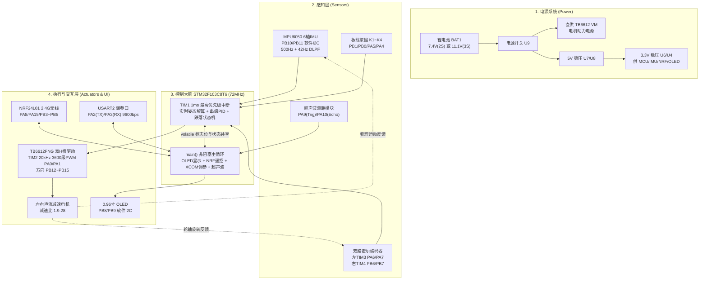
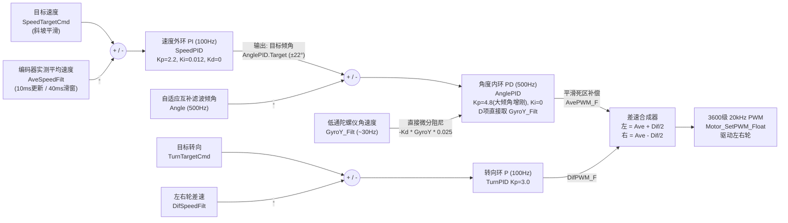
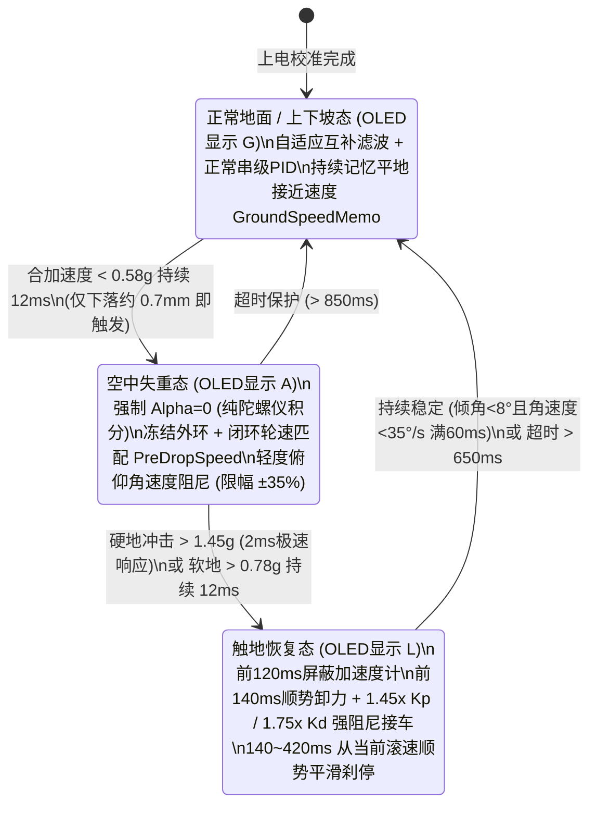
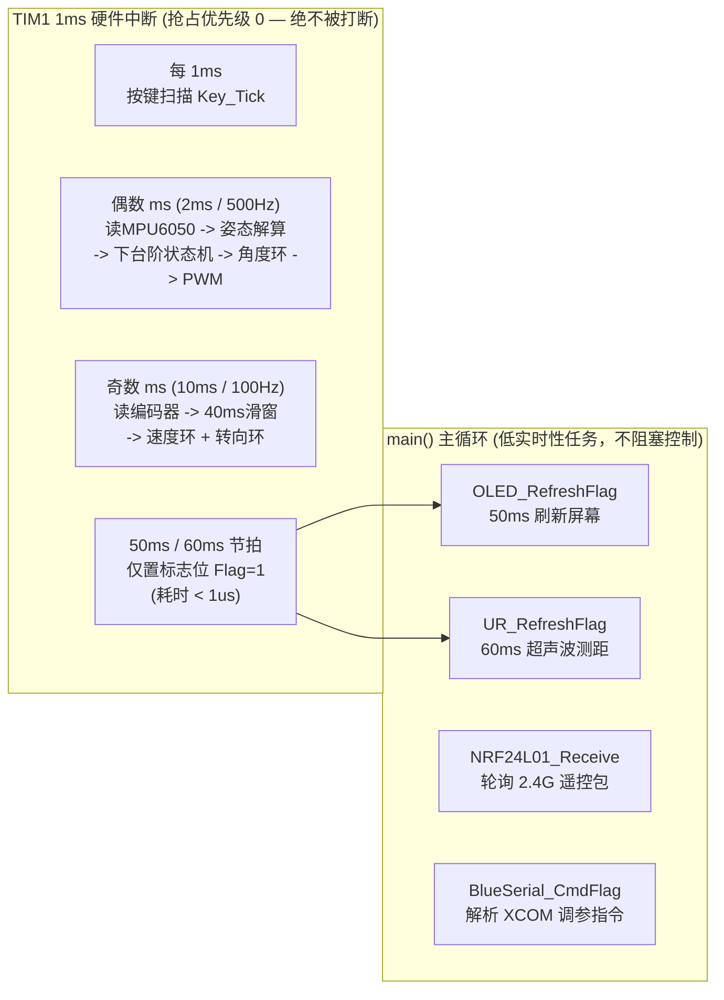

# STM32 平衡小车软硬件全栈架构与原理精要教程

> 本文档严格对应你当前的 STM32F103C8T6 平衡小车工程代码与 [小车PCB引脚原理图.pdf](./小车PCB引脚原理图.pdf)，从**物理直觉 → 硬件电路 → 软件调度 → 控制算法 → 30cm 下台阶稳姿**层层拆解，帮助入门者真正吃透整套系统。

---

## 一、软硬件总体架构图

两轮自平衡小车本质上是一个**闭环实时控制系统**：**传感器感知姿态与轮速 → 单片机高速解算并做 PID 决策 → 电机驱动输出精确力矩**，整个闭环每秒执行 500 次。

### 全车硬件引脚与驱动文件速查表

| 功能模块 | 使用引脚 | 外设 / 协议 | 对应源码 | 关键参数 |
|---|---|---|---|---|
| **MPU6050 姿态传感器** | `PB10`(SCL), `PB11`(SDA) | 软件 I2C (~350kHz) | [MyI2C.c](../firmware/Hardware/MyI2C.c), [MPU6050.c](../firmware/Hardware/MPU6050.c) | 500Hz 采样, 42Hz DLPF, `±16g`, `±2000°/s` |
| **左右电机 PWM** | `PA0`(左PWMA), `PA1`(右PWMB) | `TIM2` CH1/CH2 | [PWM.c](../firmware/Hardware/PWM.c) | `ARR=3599, PSC=0` → **20kHz / 3600 级** |
| **左右电机方向** | `PB12/PB13`(左), `PB14/PB15`(右) | 普通推挽 GPIO | [Motor.c](../firmware/Hardware/Motor.c) | TB6612FNG H桥驱动，`Motor_SetPWM_Float` |
| **左右编码器** | 左 `PA6/PA7`, 右 `PB6/PB7` | `TIM3` / `TIM4` 编码器模式 | [Encoder.c](../firmware/Hardware/Encoder.c) | 4 倍频 44 脉冲/圈 × 9.27666 = **408.17 脉冲/输出圈** |
| **核心实时定时器** | 内部时钟 | `TIM1` 更新中断 | [Timer.c](../firmware/System/Timer.c) | 1ms 周期，**抢占优先级 0（全系统最高）** |
| **NRF24L01 无线遥控** | `PA8`(CE), `PA15`(CSN), `PB3~5`(SPI) | 软件 SPI | [NRF24L01.c](../firmware/Hardware/NRF24L01.c) | 接收摇杆 `LV/RH` 与 `KEY`，支持数据回传 |
| **XCOM / 蓝牙调参口** | `PA2`(TX), `PA3`(RX) | `USART2` (9600bps) | [BlueSerial.c](../firmware/Hardware/BlueSerial.c) | 抢占优先级 2，兼容 XCOM 换行指令与 `[...]` 协议 |
| **OLED 屏幕** | `PB8`(SCL), `PB9`(SDA) | 软件 I2C | [OLED.c](../firmware/Hardware/OLED.c) | 50ms 刷新一次，显示 PID、倾角与状态 `G/A/L` |
| **超声波模块** | `PA9`(Trig), `PA10`(Echo) | GPIO 脉冲计时 | [UR.c](../firmware/Hardware/UR.c) | 60ms 节拍采样（注意与 `USART1` 共脚） |
| **按键与指示灯** | `PB1/PB0/PA5/PA4`, `PC13`, `PA11` | GPIO | [Key.c](../firmware/Hardware/Key.c), [LED.c](../firmware/Hardware/LED.c) | `K1` 启停、`K2` 自动模式、`PC13` 运行灯 |

> [!IMPORTANT]
> **硬件供电要点**：`TB6612FNG` 和 `AMS1117-5.0` 耐压上限为 15V，因此支持 **2S (7.4V~8.4V)** 或 **3S (11.1V~12.6V)** 锂电池（禁止 4S）。电池电量过低导致 `VIN < 6.3V` 时，5V/3.3V 稳压器会掉压触发 MCU 反复重启，表现为 OLED 闪屏且无法启动。

---

## 二、为什么两轮车能站起来？（物理直觉）

把平衡车想象成**“用手掌竖着托起一根扫帚”**：
1. 扫帚往**前**倒时，手掌必须往**前**加速追过去，把支撑点移到重心正下方，扫帚就会被“顶”回竖直状态。
2. 如果你想让扫帚**一直往前走**，必须先让手掌稍微往后退一点点，让扫帚**前倾一个固定角度**（比如 `5°`），然后手掌持续往前追着这个倾角跑，扫帚就会保持匀速前进。
3. 如果想**刹车停住**，手掌要猛地往前多追一点，把扫帚顶成**后仰**，靠重力把前进速度刹回来，再回到 `0°` 站稳。

用物理公式表示倒立摆的倾角动力学：

$$\ddot{\theta} = \frac{g}{L}\theta - \frac{1}{L}a_{\text{wheel}}$$

其中 $\theta$ 是车身倾角，$a_{\text{wheel}}$ 是车轮水平加速度。可以看到：
- 没有电机控制时（$a_{\text{wheel}} = 0$），$\ddot{\theta} = +\frac{g}{L}\theta$，只要偏离竖直一点点就会加速倒下（本质不稳定）。
- 当我们让车轮按倾角比例和角速度比例加速追赶（$a_{\text{wheel}} = K_p \theta + K_d \dot{\theta}$），系统就变成带阻尼的弹簧振子，从而稳定立在 `0°`！

---

## 三、姿态解算：如何准确知道车身歪了多少度？

MPU6050 同时输出 **3 轴加速度计 `(AX, AY, AZ)`** 和 **3 轴陀螺仪 `(GX, GY, GZ)`**，两者各有致命缺陷，必须融合：

| 传感器 | 物理原理 | 优点 | 致命缺点 |
|---|---|---|---|
| **加速度计** | 利用重力方向 $\theta_{\text{acc}} = -\text{atan2}(AX, AZ) \cdot \frac{180}{\pi}$ | **长期准确、无累计漂移** | 对震动、车轮加减速极其敏感；**自由落体失重时读数为 `0g`，角度直接算飞** |
| **陀螺仪** | 对角速度积分 $\theta_{\text{gyro}}(k) = \theta(k-1) + \omega_y \cdot \Delta t$ | **动态极快、抗冲击、失重时照样准** | 存在微小零漂，时间长了积分会越飘越远 |

### 本工程的三重姿态保障（[MPU6050.c](../firmware/Hardware/MPU6050.c) & [main.c](../firmware/User/main.c)）
1. **硬件第一道防线（42Hz DLPF）**：配置 `MPU6050_CONFIG = 0x03`、`SMPLRT_DIV = 0x01`（500Hz），在芯片内部先把电机与齿轮箱的高频震动滤干净，再由 STM32 每 2ms 读取一帧新鲜数据。
2. **开机自动零漂校准（`IMU_CalibrateOnBoot`）**：上电静止 160ms 自动采样算出浮点零漂 `GyroY_Offset` / `GyroZ_Offset`（如果开机时手在晃动则自动回退默认值），并用加速度计立即初始化 `Angle`，开机零等待收敛。
3. **自适应互补滤波（平地丝滑 + 下台阶不算飞的核心）**：

$$\theta(k) = \alpha \cdot \theta_{\text{acc}}(k) + (1 - \alpha) \cdot \left[\theta(k-1) + \omega_y \cdot \Delta t\right]$$

实时计算三轴合加速度模长 $a_{\text{mag}} = \frac{\sqrt{AX^2 + AY^2 + AZ^2}}{2048}$（静止为 `1.0g`）：
- **平地稳态**（$|a_{\text{mag}} - 1g| \le 0.06g$）：$\alpha = 0.0015$（时间常数约 `1.33s`），既能消除陀螺仪长期漂移，又不会被慢速加减速的水平加速度骗出虚假倾角。
- **中等扰动**（$0.06g \sim 0.20g$）：$\alpha$ 线性衰减至 `0`。
- **自由落体 / 触地冲击 120ms 内 / 剧烈颠簸**（$\ge 0.20g$）：**强制 $\alpha = 0$**，切换为 100% 纯陀螺仪积分，彻底免疫失重 `0g` 和触地高 `g` 尖峰。

---

## 四、核心控制架构：双闭环串级 PID + 转向环

如果只有“直立环”，车虽然不会倒，但只要重心稍微偏 `0.5°`，车就会为了追这个倾角越跑越快直到撞墙。因此必须采用 **速度外环 + 角度内环** 串级控制，并并联 **转向环** 控制左右差速。

### 每一环的设计原理与“防晃动”精髓

1. **角度内环（[PID.c](../firmware/User/PID.c#L54-L93)，500Hz / 2ms）**：
   - **P 项（比例，刚度）**：倾角越大，输出推力越大；当 $|Angle| > 8^\circ$（陡坡/急扰）时自动平滑放大刚度（最高 `1.25x`），实现“小倾角丝滑、大倾角抗摔”。
   - **D 项（直接陀螺仪速率阻尼）**：不用 `(Angle - Angle_prev)` 做差分（会放大噪声且随周期缩放），而是直接用低通滤波后的陀螺仪俯仰角速度 `GyroY_Filt` 产生反向阻尼力矩，相位零滞后、干净利落。
   - **为什么内环关闭 `Ki = 0`？**：如果角度环和速度环都开积分，两个积分器会互相拉扯产生低频画弧线晃动。重心偏移完全交给外环 `SpeedPID.Ki` 自动补偿。
   - **平滑死区补偿（`PID_ApplySmoothOffset`）**：直流减速电机在极低占空比时因静摩擦转不动；旧版过零直接 `±OutOffset` 阶跃跳变会引发原地来回抽动。新版改为 `0~1.0%` 线性过渡补偿，既克服静摩擦又不抽动。

2. **速度外环（[main.c](../firmware/User/main.c#L1101-L1197)，100Hz / 10ms）**：
   - **输出不是 PWM，而是“目标倾角”**：车往前溜了（`AveSpeed > Target`）→ 速度环输出负目标倾角 → 车身主动后仰把速度刹回来；下坡时积分项 `ErrorInt` 自动积累出最大 `±10.8°` 后仰角稳稳拉住车身不溜车。
   - **10ms 刷新 + 40ms 滑动窗口测速**：
     - 如果 50ms 测一次速，相位滞后大、慢速发晃；
     - 如果纯 20ms 测速，慢速时单脉冲量化太粗（`0→1→0` 跳变导致卡顿）；
     - 采用 **4 格环形缓冲（4 × 10ms = 40ms 窗口）每 10ms 滑动求和**，再叠一层轻量一阶低通，把速度环总滞后压缩到 ~35ms，同时单脉冲台阶几乎不可见。
   - **为什么外环关闭 `Kd = 0`？**：对离散编码器脉冲求微分会向目标倾角注入尖刺，直接引发车身抖动。

3. **转向环（100Hz / 10ms）**：
   - 以左右轮转速差 `DifSpeedFilt = LeftSpeed - RightSpeed` 做比例闭环；直行时对 `< 0.03 rps` 的极微小单脉冲相位差加死区，防止低速直行时左右轮互相拧劲卡顿。

4. **执行器升级（[PWM.c](../firmware/Hardware/PWM.c) & [Motor.c](../firmware/Hardware/Motor.c)）**：
   - `TIM2` 配置 `PSC = 0, ARR = 3599`，频率 $72\text{MHz} / 3600 = 20\text{kHz}$（高于人耳听觉上限，完全无电机高频啸叫），分辨率从 100 级提升至 **3600 级**，平衡点附近微调力矩丝滑 36 倍。

---

## 五、30cm 下台阶防摔稳姿状态机原理

从 `30cm` 高处下落，自由落体时间 $t = \sqrt{2h/g} \approx 0.247\text{s}$，落地瞬时竖直速度 $v = \sqrt{2gh} \approx 2.43\text{m/s}$。常规平衡代码在跌落时会同时遭遇 **4 个致命问题**：
1. 悬空失重（$a_{\text{mag}} \approx 0g$）导致 `atan2(0,0)` 把姿态角算飞；
2. 悬空轮子无负载，普通 PID 瞬间飞车或抱死，触地瞬间轮胎与地面速度不匹配把车身“绊翻”；
3. 速度环在空中积分饱和，落地瞬间输出错误大倾角指令；
4. 触地 `5g~14g` 冲击污染倾角，且普通倾倒保护（`52°`）在救车瞬间误停机。

为此我们在 [main.c](../firmware/User/main.c#L298-L398) 中实现了**三态跌落恢复状态机**：

### 下台阶全流程物理拆解
1. **离地瞬间（0 ~ 12ms）**：平时地面运行一直用慢滤波 `GroundSpeedMemo` 记住真实前进速度；刚离地仅下落 **0.7mm**（12ms），`AccMagG < 0.58g` 立即切入 `AIRBORNE`，锁存 `PreDropSpeed` 并清空速度/转向环积分。
2. **空中阶段（12 ~ 247ms）**：
   - `Alpha = 0`，靠陀螺仪精准跟踪空中姿态；
   - 车轮不飞车也不抱死，而是用闭环精准维持在 `PreDropSpeed`（触地瞬间轮缘线速度与地面相对速度接近 0，**不“绊脚”不前栽**），同时叠加轻度 `GyroY` 阻尼抑制前翻。
3. **触地救车阶段（0 ~ 140ms）**：
   - 硬质地面冲击 `> 1.45g` **单帧 2ms 立即识别触地**；
   - 继续屏蔽加速度计 120ms，防冲击毛刺；
   - **顺势卸力（Free-Roll）**：前 140ms 暂不让速度环硬刹，目标倾角 `0°`，让车轮顺着前冲惯性自由追回重心，同时临时将角度环增益拉高至 **`1.45x Kp`、`1.75x Kd`**，并将倾倒保护角临时放宽到 **`68°`**（40ms 防抖），把全部电机动力用来立稳车身！
4. **平滑刹停阶段（140 ~ 420ms）**：
   - 速度环重新接管时，目标速度**不是直接跳到 `0`**，而是从触地后当前滚速的 `70%` 线性斜坡降到 `0`（像人跳下台阶后顺势向前缓冲一步再站定），彻底消除触地急刹后仰摔车。

---

## 六、实时任务调度与中断优先级设计

STM32F103C8T6 没有浮点运算单元（FPU），所有浮点运算靠软件完成，因此**中断分层、错峰与非阻塞设计**决定了小车稳不稳：

- **奇偶毫秒错峰**：`SpeedDivCnt` 初始为 `1`，保证 500Hz 角度环（偶数 ms）与 100Hz 速度环（奇数 ms）**永不在同一毫秒撞车**，单次中断稳稳控制在 1ms 以内（OLED 右下角 `OB:0` 后无 `!` 即表示从未超时）。
- **抢占优先级**：`TIM1` = **0（最高）**，`USART2` = **2（最低）**，保证串口收发绝不打断姿态解算。
- **栈空间安全**：启动文件 [startup_stm32f10x_md.s](../firmware/Start/startup_stm32f10x_md.s#L33) 已将栈扩大至 `2KB (0x800)`，`BlueSerial_Printf` 使用静态缓冲，杜绝 `printf` 与中断嵌套导致的栈溢出。

---

## 七、入门者快速掌握与调参排错速查

### 推荐代码阅读顺序（半小时读懂全工程）
1. [Timer.c](../firmware/System/Timer.c) → 看懂 1ms 节拍怎么来、优先级怎么配；
2. [MPU6050.c](../firmware/Hardware/MPU6050.c) + [MyI2C.c](../firmware/Hardware/MyI2C.c) → 看懂 6 轴数据怎么按 500Hz 读进来；
3. [PWM.c](../firmware/Hardware/PWM.c) + [Motor.c](../firmware/Hardware/Motor.c) + [Encoder.c](../firmware/Hardware/Encoder.c) → 看懂电机怎么动、编码器怎么测速；
4. [PID.c](../firmware/User/PID.c) → 看懂直接陀螺仪微分、条件抗积分饱和和平滑死区补偿；
5. [main.c](../firmware/User/main.c) → 最后通读 `IMU_CalibrateOnBoot`、`DropStateMachine_Update`、`TIM1_UP_IRQHandler` 与 `main()` 主循环。

### 常见现象与一招定位排错表

| 实车现象 | 核心原因 | 解决方式（XCOM 串口指令或硬件检查） |
|---|---|---|
| **启动不了 + OLED 一闪一闪** | 电池电量低/内阻大导致 5V 稳压掉压反复重启 | 测电池电压并充满电（2S 满电 `8.4V`，3S 满电 `12.6V`），拔掉 ST-Link 单独用电池上电 |
| **原地高频细碎嗡嗡抖** | `AngleKp` 或 `AngleKd` 偏大，或 `Offset` 过大 | 依次减小 `akd`（如 `2.8 → 2.2`）或 `off`（如 `2.0 → 1.5`） |
| **慢速一顿一顿发晃** | `Offset` 偏小导致电机静摩擦粘滑，或 `SpeedKp/Ki` 偏大 | 在 `1.0 ~ 4.5` 之间微调 `off`，适当回调 `skp` |
| **原地一直往一边溜车** | 机械零点偏移 | 发 `zero=` 微调机械零点，直到关闭速度环时也能大致原地立稳 |
| **下坡压不住越溜越快** | 速度环后仰制动力不够 | 适当增大 `skp`（如 `2.2 → 2.8`）和 `ski`（如 `0.012 → 0.018`） |
| **30cm 下台阶触地前栽** | 触地救车刚度/阻尼不够，或电池电压不足 | 满电测试；增大 `lkp`（`1.65`）、`lkd`（`2.1`），拉长 `lroll`（`180`） |
| **30cm 下台阶触地后仰翻** | 速度环接管刹车过早过猛 | 拉长顺势卸力时间 `lroll`（如 `140 → 200`） |
